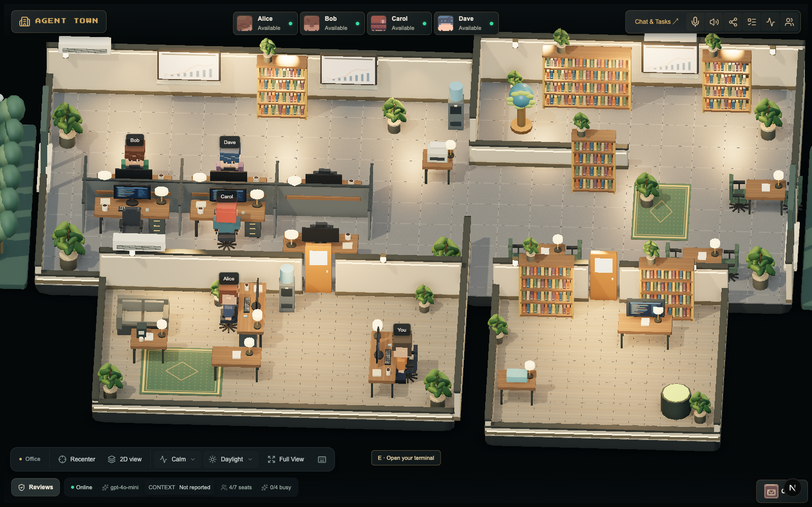
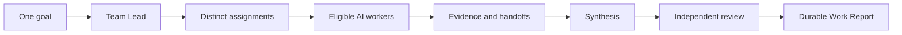
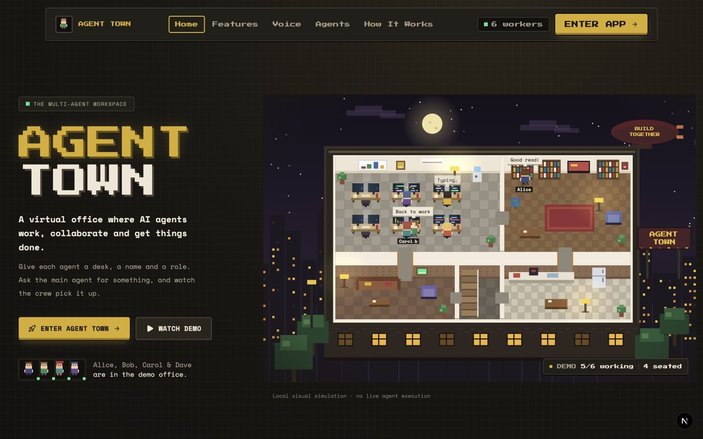
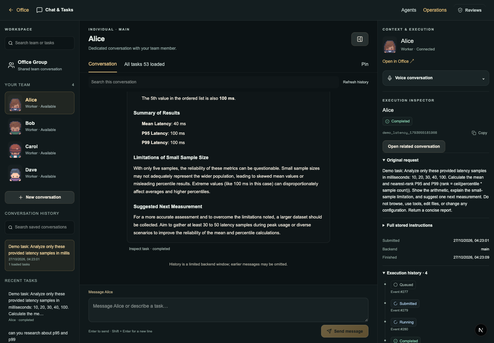
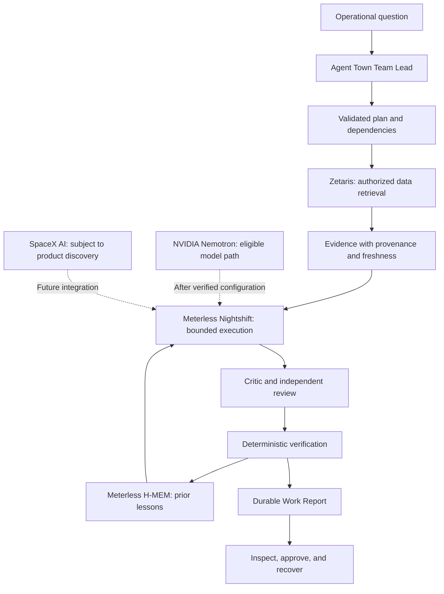
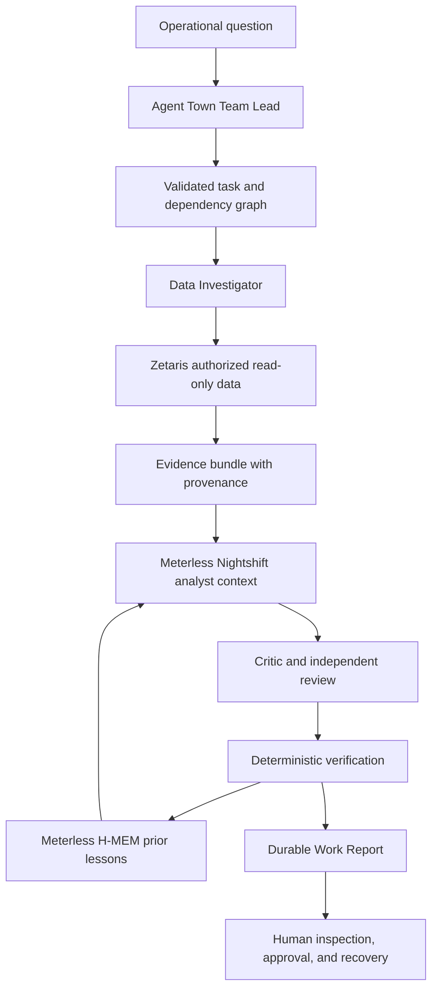
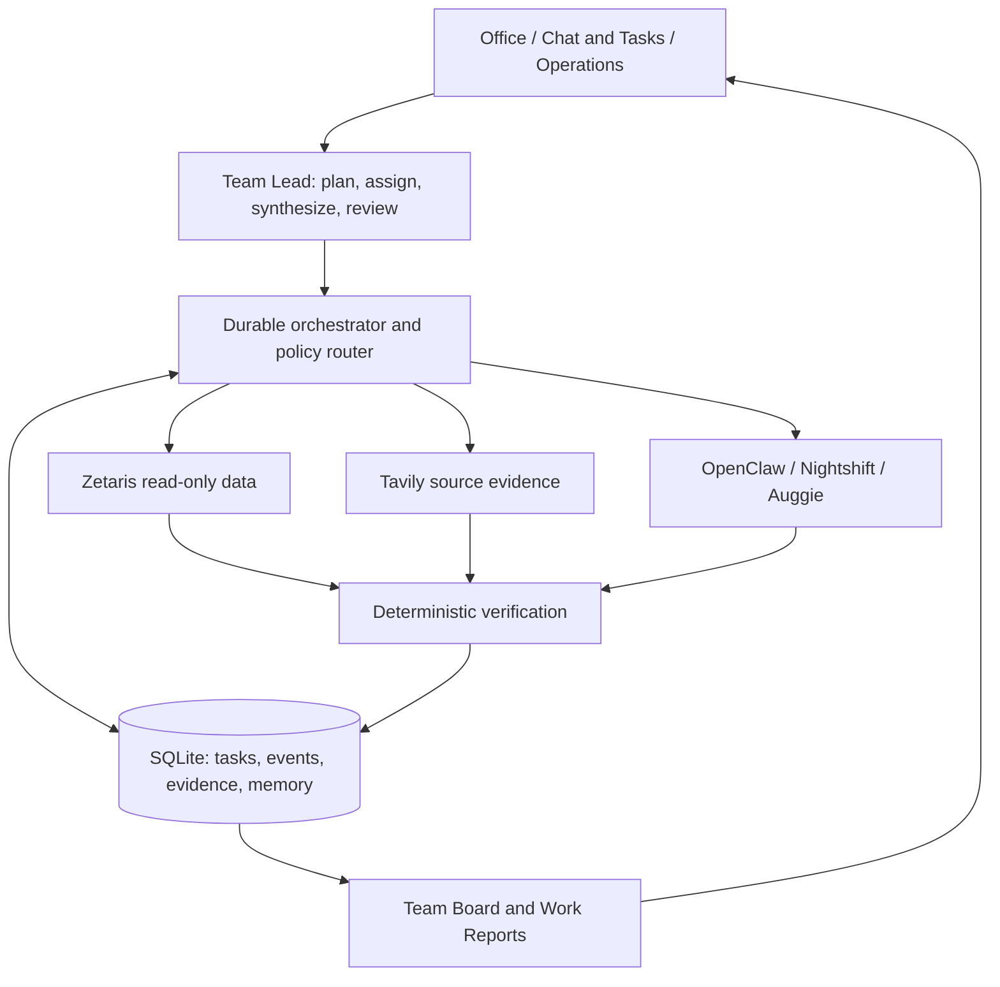

<div align="center">

# Agent Town

### An inspectable AI operations team.

**Coordinate specialized workers, investigate approved data, challenge conclusions, and preserve the evidence behind every decision.**

[](https://github.com/rajatnagda45/agent-town/actions/workflows/ci.yml)
[](package.json)
[](.node-version)

[See the product](#one-request-a-coordinated-team-of-ai-workers) · [Watch the demo](#demo) · [Run locally](#quick-start) · [Sponsor architecture](#sponsor-architecture-one-decision-pipeline) · [Inspect the proof](#proof-not-promises)

</div>



_The real application: choose a teammate, start a conversation, and follow the work into its execution record._

## The problem

AI can produce an answer in seconds. Trusting that answer still takes work.

An engineering or operations lead must reconstruct what was requested, who handled each part, which data was used, whether a step failed, and whether the result survived review. In most agent products, that context is scattered across chat windows and disappears when the session ends.

**Agent Town makes the work itself visible.** A Team Lead can split one goal into distinct assignments, route them to eligible workers, respect dependencies, synthesize the outputs, and send the result through an independent review. Every task, event, source, handoff, uncertainty, and decision is preserved in a durable Work Report.

The spatial office is not decoration around a chatbot. It is the front door to an inspectable system of work.

## One request. A coordinated team of AI workers.



1. **Ask the office.** Send one bounded goal from Chat & Tasks or Operations.
2. **Let the Team Lead plan.** The server creates one to five non-overlapping assignments, validates dependencies, and rejects cyclic plans.
3. **Watch the team work.** The Team Board shows owners, phases, dependencies, handoffs, uncertainties, queued guidance, and stop requests in real time.
4. **Ground the answer.** Approved workflows can attach Zetaris query records, Tavily sources, calculations, and provider execution events.
5. **Review before accepting.** Synthesis and independent critique are separate stages; deterministic checks decide whether supported investigations can be verified.
6. **Keep the decision.** SQLite persistence, SSE updates, full-text search, and per-task Work Reports make the work recoverable after reload or restart.



_The landing page introduces the office metaphor. Its animated scene is a labeled local simulation; execution begins inside the application._

### The workers are roles, not costumes

| Worker responsibility       | Output                                    | Guardrail                                                                            |
| --------------------------- | ----------------------------------------- | ------------------------------------------------------------------------------------ |
| **Team Lead / Planner**     | Validated assignment and dependency graph | The server rejects duplicate IDs, overlapping deliverables, and cyclic plans.        |
| **Data Investigator**       | Approved records with source provenance   | Queries are bounded and read-only; retrieved content remains untrusted input.        |
| **Analyst**                 | Calculations, findings, and uncertainty   | Dispatch requires eligible capabilities, identity bindings, and policy approval.     |
| **Critic / Reviewer**       | Objections, gaps, and revision requests   | A critic cannot independently certify an unsupported result.                         |
| **Memory Steward**          | Scoped prior lessons and feedback         | Provenance, freshness, conflict, and supersession rules prevent blind reuse.         |
| **Verification Controller** | Accepted, rejected, or incomplete state   | Deterministic source, citation, arithmetic, and execution checks control the status. |

The same backend may fill more than one visible seat. Agent Town records the actual provider, agent, session, task, and role bindings instead of pretending each avatar is automatically an independent model.

## What judges can experience

| Surface               | What it demonstrates                                                                                                     |
| --------------------- | ------------------------------------------------------------------------------------------------------------------------ |
| **3D and 2D office**  | A memorable, navigable way to discover named teammates and enter their conversations.                                    |
| **Chat & Tasks**      | Dedicated conversations, Office Group collaboration, Markdown/code results, search, and durable task inspection.         |
| **Team Board**        | Live assignments, dependency state, handoffs, revisions, uncertainty, steering, and safe stop controls.                  |
| **Operations**        | Natural-language investigation entry, capability readiness, reviewed data scopes, and decision records.                  |
| **Work Report**       | One shareable page for the brief, lifecycle, provider decision, evidence, query provenance, memory, and exportable JSON. |
| **Cross-task search** | SQLite FTS5/BM25 retrieval over prior work without spending another model call.                                          |
| **Emergency stop**    | Pause new work without killing in-flight tasks or corrupting their execution history.                                    |



_A real provider-backed analysis. The answer, original request, stable task identity, and lifecycle remain together._

## A concrete, reproducible result

The repository contains a recorded run in which Alice analyzed the supplied latency samples `10, 20, 30, 40, 100 ms`:

- arithmetic mean: **40 ms**;
- nearest-rank P95 and P99: **100 ms**;
- correct limitation: five observations do not establish production tail latency;
- result, request, task identity, and execution events remained available after reload.

This is deliberately a small case: judges can verify the arithmetic in seconds and then inspect the much harder part—the execution trail and recovery behavior. See the [sanitized evidence manifest](docs/evidence/demo-manifest-20261027.json).

## The flagship workflow: supplier delivery decisions

An operations lead asks why purchase order `PO-1042` shows **100 units ordered but only 85 received**. A single plausible explanation is unsafe: the remaining 15 units could be missing, in transit, delivered but unrecorded, or hidden by stale evidence.

| Stage        | Agent Town responsibility                                                                                 | Inspectable output                                               | Current proof level                                                      |
| ------------ | --------------------------------------------------------------------------------------------------------- | ---------------------------------------------------------------- | ------------------------------------------------------------------------ |
| 1. Plan      | Team Lead decomposes the question into bounded, non-overlapping assignments.                              | Task graph, owners, dependencies, and completion criteria.       | Implemented and automated-test covered.                                  |
| 2. Retrieve  | Data Investigator requests the approved purchase order, receipt, shipment, and supplier records.          | Zetaris query lifecycle, source IDs, timestamps, and read audit. | Adapter tested; historical live reads; final combined run pending.       |
| 3. Analyze   | Analyst calculates the 15-unit discrepancy and identifies missing facts.                                  | Findings, calculations, evidence references, and uncertainty.    | Workflow tested; live Nightshift acceptance pending.                     |
| 4. Challenge | Critic tests assumptions and requests a bounded revision when evidence is insufficient.                   | Critic verdict, objections, and revision history.                | Implemented and automated-test covered; live sponsor case pending.       |
| 5. Verify    | Deterministic checks evaluate source freshness, completeness, citations, arithmetic, and execution state. | Verified, rejected, or incomplete status with reasons.           | Implemented and automated-test covered.                                  |
| 6. Remember  | H-MEM retrieves the previous finding with provenance and learns whether fresh evidence confirms it.       | Source task, confidence feedback, conflict, and lineage.         | Vendored reference engine passes 13/13 locally; no hosted-service claim. |
| 7. Decide    | Team Lead synthesizes evidence, uncertainty, and allowed next actions.                                    | Durable Work Report with a human-approval boundary.              | Implemented; complete live sponsor acceptance pending.                   |
| 8. Recover   | The same task, evidence, and decision are reopened after reload or restart.                               | Stable IDs, lifecycle, result, and dispatch history.             | Proven for core execution; sponsor-case recovery not yet tested.         |

The included supplier records are explicitly **synthetic demonstration data**, isolated in `AGENT_TOWN_SUPPLIER_DEMO`; they are not enterprise production records. Day two introduces fresh evidence that contradicts the earlier finding, demonstrating why memory must receive feedback instead of repeating yesterday's conclusion. The [supplier demo](docs/DEMO_SUPPLIER.md) includes the dataset specification and reproduction steps.

## Demo

> 🎬 **Final demo video reserved here.** The reviewed video link will replace this note before submission.

<!-- DEMO_VIDEO: Replace this note with the final public 1–4 minute video link. -->

Until then, use the [timed walkthrough and shot list](docs/DEMO_SCRIPT.md), [reproduction runbook](docs/DEMO_RUNBOOK.md), or [supplier decision demo](docs/DEMO_SUPPLIER.md). The sanitized [demo evidence manifest](docs/evidence/demo-manifest-20261027.json) identifies the existing real-provider tasks without distributing the private runtime database. The [animated walkthrough](public/demo/index.html) is a scripted product illustration, not a substitute for the final video or a provider-execution claim.

### Suggested three-minute judge path

1. Enter the office and ask the Team Lead for a bounded goal.
2. Open the Team Board to show distinct assignments, owners, and dependencies.
3. Open one task's Work Report and inspect its lifecycle, provider, sources, and handoffs.
4. Show the supplier decision changing when fresh records conflict with remembered evidence.
5. Reload the application and reopen the same durable work.

## Sponsor architecture: one decision pipeline

Agent Town brings together data retrieval, specialized agent execution, decision memory, and evidence-based verification to turn an operational question into an inspectable, recoverable decision. Each technology contributes to a defined stage of the workflow, with execution identity, provenance, and verification boundaries preserved throughout.

| Technology               | Product role and entry point                                                                                                                                      | What it contributes                                                                                                                                                              | Evidence and current status                                                                                                                                                                                                                                                                                                                                                                                          |
| ------------------------ | ----------------------------------------------------------------------------------------------------------------------------------------------------------------- | -------------------------------------------------------------------------------------------------------------------------------------------------------------------------------- | -------------------------------------------------------------------------------------------------------------------------------------------------------------------------------------------------------------------------------------------------------------------------------------------------------------------------------------------------------------------------------------------------------------------- |
| **Zetaris**              | Operational evidence source through [`data-zetaris.mjs`](lib/server/data-zetaris.mjs).                                                                            | Authenticated, bounded, read-only SQL; response mapping; source provenance; freshness validation; and query auditing.                                                            | **Implemented and contract-tested, with historical live-read evidence.** The adapter enforces bounded access and preserves query audit information. Historical tests correctly rejected stale synthetic records rather than reporting a false verification pass. Final acceptance requires a fresh approved read within the complete supplier investigation and confirmation that the source audit survives restart. |
| **Meterless Nightshift** | Specialized execution provider through the [Nightshift gateway](lib/server/nightshift-gateway.mjs) and [role enforcement](lib/server/nightshift-enforcement.mjs). | Role-bound planning, analysis, and critique contexts connected to Agent Town's durable task orchestration, with execution results and lifecycle events available for inspection. | **Implemented and contract-tested, with partial historical live evidence.** Automated coverage verifies the adapter and role restrictions. Complete acceptance requires authenticated discovery, confirmed model identity, eligible analyst and critic execution, terminal outputs, and recovery evidence from the same investigation.                                                                               |
| **Meterless H-MEM**      | Decision memory through the [vendored reference engine](lib/vendor/hmem-reference/README.md) and Agent Town's scoped SQLite memory path.                          | Provenance-aware recall, feedback, contradiction handling, supersession, and an auditable history of prior lessons used in later decisions.                                      | **Vendored reference-engine conformance: 13/13 passed.** The local engine's tested behavior is documented, alongside the separate SQLite-backed lesson store. Complete workflow acceptance requires recording the exact memory read, supporting source task, feedback/write event, and recovered result after restart; hosted H-MEM acceptance is not implied by local conformance.                                  |
| **NVIDIA / Nemotron**    | Potential model provider for bounded worker execution, subject to an authorized configuration and explicit provider/model identity.                               | A model-backed reasoning path for eligible analysis or review tasks, with outputs routed through Agent Town's existing evidence and verification controls.                       | **Integration target defined; execution must be evidenced.** Acceptance requires a configured authorized provider, discovered Nemotron model identity, a completed bounded task, and a sanitized execution receipt linking the model to the task. Generic routing labels alone do not establish model provenance.                                                                                                    |
| **SpaceX AI**            | Potential future provider integration, subject to identifying an applicable official product and supported API.                                                   | A sponsor-relevant capability can be incorporated only after its actual product boundary and technical fit are established.                                                      | **Integration discovery required.** First establish the official product, API contract, authentication requirements, and supported use case. Only then implement a bounded adapter and verify it with a real execution receipt. No product integration or runtime usage is claimed without that evidence.                                                                                                            |

### How the technologies fit together



### Reference workflow and current acceptance boundary

This is the implemented product architecture and the intended complete sponsor trace. Its individual components exist, but the entire path has **not yet passed as one live retained run**.



Connection probes, mocked tests, and a complete live investigation are reported separately. The [installed Zetaris contract](docs/zetaris-installed-contract.md), checked-in tests, and the safe [environment template](.env.example) make the integration boundaries reproducible.

### Why this architecture is different

| Approach                    | Coordination                                                    | Evidence                                                             | Review and memory                                       | Recovery                                                    |
| --------------------------- | --------------------------------------------------------------- | -------------------------------------------------------------------- | ------------------------------------------------------- | ----------------------------------------------------------- |
| **Single chatbot**          | One response                                                    | Often embedded in prose                                              | Self-review in the same context                         | Usually conversation-level                                  |
| **Unstructured agent chat** | Multiple contributions without enforced dependencies            | Varies by agent                                                      | Handoffs may be informal                                | Difficult to reconstruct                                    |
| **Agent Town**              | Server-validated tasks, dependencies, eligibility, and handoffs | Source identities, query audits, citations, and deterministic checks | Separate critique plus provenance-aware memory feedback | Stable task IDs, lifecycle events, SQLite, and Work Reports |

### Supporting integrations

| Technology             | Role                                                                                                              |
| ---------------------- | ----------------------------------------------------------------------------------------------------------------- |
| **OpenClaw**           | Verified core office/chat provider on the current Mac, including durable real-provider demonstrations.            |
| **Auggie**             | Optional local agent provider through Agent Town's protocol bridge.                                               |
| **Google Gemini Live** | Optional low-latency voice conversation with constrained ephemeral browser credentials and persisted transcripts. |
| **Tavily**             | Reviewed web search and extraction whose result URLs become audited, source-linked evidence.                      |

## Architecture



**Stack:** Next.js 16 · React 19 · TypeScript · Three.js · Phaser 3 · Tailwind CSS 4 · Node SQLite · SSE · Vitest · Puppeteer.

Three rules shape the implementation:

- **The server owns execution.** Stable task IDs, checked bindings, grants, dependency gates, circuit breakers, and durable events decide what can run.
- **Evidence controls verification.** Missing authorization, stale records, invalid citations, failed arithmetic, or uncertain execution prevent a verified result.
- **People keep authority.** Steering and approval are explicit. Stop requests and ambiguous provider outcomes remain visible instead of being silently rewritten.

## Proof, not promises

The current code at commit [`31d585e`](https://github.com/rajatnagda45/agent-town/commit/31d585ebed76b2e764591825fea096eb17504aa5) passes GitHub CI and the full local release gate.

| Evidence                                                                         | Result                                 | What it proves                                                                                                                        |
| -------------------------------------------------------------------------------- | -------------------------------------- | ------------------------------------------------------------------------------------------------------------------------------------- |
| [GitHub CI](https://github.com/rajatnagda45/agent-town/actions/runs/40529432468) | **Passed** on the current commit       | Frozen install, formatting, lint, types, build, and automated tests.                                                                  |
| Full local release gate                                                          | **1,026 tests across 99 files passed** | Unit/integration regression coverage plus production build, isolated browser flows, archive extraction/startup, and dependency audit. |
| [H-MEM conformance receipt](docs/evidence/hmem-conformance.txt)                  | **13/13 passed**                       | The vendored Meterless reference engine satisfies its included official conformance suite.                                            |
| [Real provider analysis](docs/evidence/demo-manifest-20261027.json)              | **Completed and recovered**            | Correct bounded analysis, durable identity, lifecycle events, and reload recovery.                                                    |
| [Office Group receipt](docs/evidence/team-demo-20261027.json)                    | **Four persisted contributions**       | Sequential shared-context collaboration through one recorded backend agent; not four independent models.                              |

The checks establish implementation quality and traceability. They do not substitute for user studies. The [impact protocol](docs/IMPACT_EVALUATION.md) and blank [trial template](docs/evidence/impact-trials-template.csv) define paired manual-versus-Agent-Town measures for review time, correctness, citation coverage, and recovery; no productivity percentage or ROI is claimed before those trials exist.

## Quick start

### 1. Install

Use **Node.js ≥22.19.0** and **pnpm 10.20.0**.

```sh
git clone https://github.com/rajatnagda45/agent-town.git
cd agent-town
pnpm install --frozen-lockfile
```

### 2. Start the verified core provider

With an authenticated OpenClaw installation:

```sh
openclaw gateway start
```

Create an ignored `.env.local`:

```env
AGENT_PROVIDER=openclaw
GATEWAY_URL=ws://127.0.0.1:18789/
# Optional: override the token read from local OpenClaw configuration.
# GATEWAY_TOKEN=your_private_gateway_token
```

### 3. Run Agent Town

```sh
pnpm dev
```

Open [the office](http://localhost:3000/app) or [Chat & Tasks](http://localhost:3000/app/chat). Use **WASD / arrow keys** to move and **E** at an interaction prompt.

For production, run `pnpm build` and `pnpm start`. The custom server is required for the durable task runtime; `pnpm dev:next` does not start it.

<details>
<summary><strong>Configure Meterless Nightshift and Zetaris</strong></summary>

Use a Nightshift installation that exposes its API. The free M1–M4 Mac browser edition does not expose the native local API.

```env
AGENT_PROVIDER=nightshift
NIGHTSHIFT_BASE_URL=http://127.0.0.1:8088/v1
NIGHTSHIFT_API_KEY=your_private_runtime_proxy_token
NIGHTSHIFT_MODEL=meterless/auto
AGENT_TOWN_INVENTORY_MODE=zetaris
```

Add the exact Zetaris open, page, and close endpoints; bearer credential; organization scope; response mappings; and methods from the [installed contract](docs/zetaris-installed-contract.md). A base URL alone is not enough. Keep every credential server-side.

```sh
pnpm nightshift:check
node --env-file-if-exists=.env.local scripts/check-zetaris.mjs
```

These commands establish connectivity, not a completed investigation.

</details>

<details>
<summary><strong>Add voice or use another port</strong></summary>

For optional voice, add `GEMINI_API_KEY`, restart, choose a teammate's **Voice** tab, and start a call. Microphone permission and provider quota are required.

If port 3000 is occupied, launch with `PORT=3107 pnpm dev`. SQLite defaults to `~/.agent-town/tasks.sqlite`; override it with `AGENT_TOWN_DB_PATH`. Run one process per database and retain that database to preserve work.

</details>

## Run the same checks

```sh
pnpm format:check
pnpm lint
pnpm typecheck
pnpm test
pnpm build
```

After building, `pnpm phase3:check` runs isolated browser acceptance with mocked provider and voice transports. `pnpm release:check` also creates and validates an extracted release archive. Neither command is presented as live sponsor execution.

## Security and operating boundaries

- Permanent provider credentials remain server-side; Gemini Live receives only a constrained ephemeral token.
- Zetaris access is bounded to approved read-only queries. Models cannot choose arbitrary SQL or write methods.
- Provider responses and web content are treated as untrusted data, not executable instructions.
- Agent Town is a local, single-workspace application. Public deployment requires an authenticated TLS reverse proxy; built-in multi-tenant authentication is outside the current scope.
- Accessibility has responsive and interaction coverage, but no formal WCAG conformance claim.

## Submission resources

- [Demo script](docs/DEMO_SCRIPT.md) · [demo runbook](docs/DEMO_RUNBOOK.md) · [supplier scenario](docs/DEMO_SUPPLIER.md)
- [Presentation content](docs/PRESENTATION_CONTENT.md)
- [Sanitized demo manifest](docs/evidence/demo-manifest-20261027.json) · [sponsor integration contract](docs/zetaris-installed-contract.md)
- [Impact evaluation protocol](docs/IMPACT_EVALUATION.md)

## Project scope

Agent Town's repository history begins before the hackathon. The event-window work adds and hardens dedicated conversations, durable execution inspection, Team Lead delegation, Team Board and Work Reports, source-linked research, sponsor adapters, H-MEM decision memory, lifecycle diagnosis, emergency-stop behavior, and evidence-based verification. The [commit history](https://github.com/rajatnagda45/agent-town/commits/main/) preserves that timeline.

---

<div align="center">

### Delegate the work. Inspect the evidence. Keep the decision.

</div>
